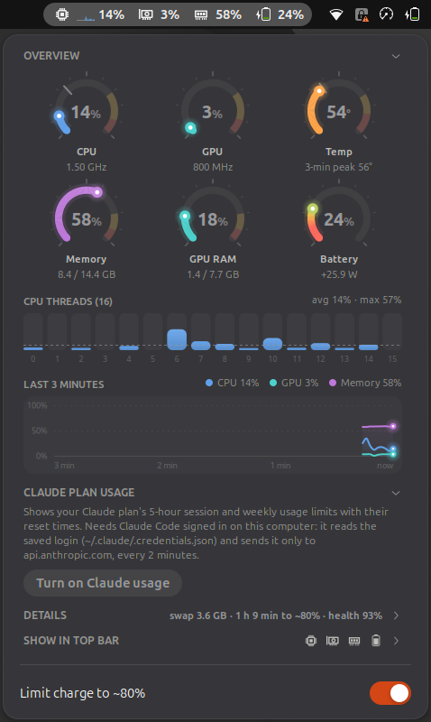
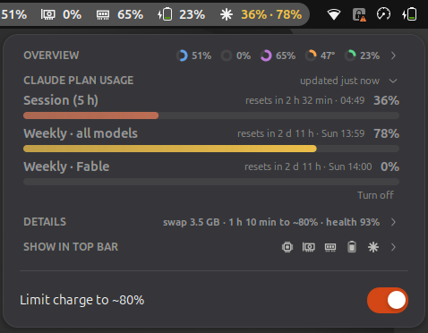

# Sys Stats AI

A GNOME Shell extension (GNOME 48–50) that shows system stats in the top bar,
with live gauges and graphs, plus your **Claude plan usage limits**.

<p>
  
  
</p>

## What it shows

**Top bar:** icons with live values for any of CPU (with a mini graph), GPU,
memory, temperature, battery and Claude usage (`session · weekly`). Values turn
amber or red when high. Pick what appears under *Show in top bar*.

**Menu**, in collapsible groups:

- **Overview**
  - Gauges for CPU (with clock), GPU (with clock), temperature, memory, GPU
    memory and battery (with power draw). Each arc shades towards amber and red
    as it climbs, the track marks where "high" starts, and a tick marks the
    peak of the last 3 minutes.
  - One heat-coloured bar per CPU thread, with the average marked and
    `avg · max` shown.
  - A smoothed 3-minute graph of CPU, GPU and memory with their current values.
- **Claude plan usage** (optional, off by default): your **5-hour session** and
  **weekly** usage limits, plus any per-model weekly limit, each with its reset
  time (`resets in 2 h 32 min · 04:49`), refreshed every 2 minutes.
- **Details:** load average, swap, GPU memory split (VRAM / shared), GPU clock,
  temperature and chip power, battery power, time left or time to full, drain
  since unplugged, and battery health and cycles.
- **Show in top bar:** tick the items you want in the top bar.

A collapsed group shows a one-line summary in its header (mini rings, mini bars
or text). The menu scrolls when it is taller than the screen. Your choices are
remembered.

On Lenovo IdeaPad laptops, a **Limit charge to ~80%** switch toggles battery
conservation mode.

## Install

From [extensions.gnome.org](https://extensions.gnome.org/) once it is approved:
search for **Sys Stats AI**, or use the Extension Manager app.

From source:

```sh
git clone https://github.com/StartSWest/sys-stats-ai
cd sys-stats-ai
./pack.sh
gnome-extensions install --force dist/sys-stats-ai@startswest.github.io.shell-extension.zip
```

Log out and back in, then `gnome-extensions enable sys-stats-ai@startswest.github.io`.

## What it reads

| Data | Source |
|---|---|
| CPU, memory, swap | `/proc/stat`, `/proc/meminfo`, `/proc/loadavg`, cpufreq |
| CPU temperature | hwmon `k10temp`, `coretemp` or `zenpower` |
| GPU | `amdgpu` sysfs (`gpu_busy_percent`, `mem_info_*`, hwmon); AMD GPUs only |
| Battery | `/sys/class/power_supply` |
| Charge limit | `ideapad_acpi` `conservation_mode`; Lenovo IdeaPad only |
| Claude usage | `~/.claude/.credentials.json`, written by [Claude Code](https://claude.com/claude-code); only when turned on |

Sections whose hardware is missing are hidden.

### Claude usage and your login

Claude usage is off until you press **Turn on Claude usage** in the menu. When
on, the extension reads the OAuth token that Claude Code saves in
`~/.claude/.credentials.json` and calls `https://api.anthropic.com/api/oauth/usage`
(the endpoint behind Claude Code's `/usage`) every 2 minutes. The token is only
read and sent to `api.anthropic.com`. It is never refreshed, stored or sent
anywhere else. If the login expires, run `claude` once to renew it. The
endpoint is not a documented public API and may change.

### Charge limit permissions

The conservation-mode file is root-only by default.
`contrib/battery-conservation.service` turns conservation mode on at boot and
makes the file writable by the `sudo` group, so the switch works without a
password:

```sh
sudo cp contrib/battery-conservation.service /etc/systemd/system/
sudo systemctl enable --now battery-conservation.service
```

## Development

- `./pack.sh` builds the zip for extensions.gnome.org in `dist/`.
- `stats.js` and `claude.js` only depend on GLib, Gio and Soup and run under
  `gjs -m` outside the shell.
- To try UI changes without touching your session, run a separate headless
  shell. Set `XDG_RUNTIME_DIR`, `XDG_CONFIG_HOME` and `XDG_DATA_HOME` to scratch
  directories *before* `dbus-run-session`, so its settings stay separate from
  yours. Then run
  `gnome-shell --headless --wayland --virtual-monitor 1536x960` and take
  screenshots over D-Bus.

## License

GPL-2.0-or-later, like GNOME Shell.
