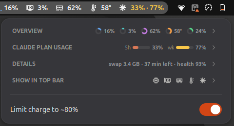

# Laptop Monitor

A GNOME Shell extension (GNOME 48–50) that puts CPU, GPU, memory, temperature,
battery and **Claude plan usage** in the top bar, with a popup of gauges, graphs
and details.

<p>
  
  
</p>

## Features

- **Top bar** — icons with live values for CPU (with a mini graph), GPU,
  memory, temperature, battery and Claude usage (`session · weekly`). Values turn
  amber/red when high. Pick what shows under *Show in top bar*.
- **Overview**
  - Gauges for CPU, GPU, temperature, memory, GPU memory and battery. The arc
    shades towards amber/red as it climbs, the track marks where "high" starts,
    and a tick shows the peak of the last 3 minutes.
  - One heat-coloured bar per CPU thread, with the average marked.
  - A smoothed 3-minute graph of CPU, GPU and memory with their current values.
- **Claude plan usage** — 5-hour session and weekly limits with reset times,
  refreshed every 2 minutes.
- **Details** — load average, swap, GPU memory split (VRAM / shared), GPU clock,
  battery power, time left, drain since unplugged and battery health.
- **Collapsible groups** — each group collapses to a one-line summary; the menu
  scrolls when it is taller than the screen. Collapsed groups are remembered.
- **Charge limit switch** — toggles Lenovo IdeaPad *conservation mode* (stops
  charging at ~80%).

## Requirements and what it reads

| Data | Source |
|---|---|
| CPU, memory, swap | `/proc/stat`, `/proc/meminfo`, `/proc/loadavg`, cpufreq |
| CPU temperature | hwmon `k10temp`, `coretemp` or `zenpower` |
| GPU | `amdgpu` sysfs (`gpu_busy_percent`, `mem_info_*`, hwmon) — AMD GPUs only |
| Battery | `/sys/class/power_supply` |
| Charge limit | `ideapad_acpi` `conservation_mode` — Lenovo IdeaPad only |
| Claude usage | `~/.claude/.credentials.json` (written by [Claude Code](https://claude.com/claude-code)) |

Sections whose hardware is missing are hidden.

### Claude usage and your login

The Claude section reads the OAuth token that Claude Code stores in
`~/.claude/.credentials.json` and calls `https://api.anthropic.com/api/oauth/usage`
(the endpoint behind Claude Code's `/usage`) every 2 minutes. The token is only
read and sent to `api.anthropic.com`; it is never refreshed, stored or sent
anywhere else. If the login expires, run `claude` once to renew it. This
endpoint is not a documented public API and may change.

### Charge limit permissions

The sysfs file is root-only by default. `contrib/battery-conservation.service`
turns conservation mode on at boot and makes the file writable by the `sudo`
group, so the switch works without a password:

```sh
sudo cp contrib/battery-conservation.service /etc/systemd/system/
sudo systemctl enable --now battery-conservation.service
```

## Install

```sh
git clone https://github.com/StartSWest/gnome-laptop-monitor \
  ~/.local/share/gnome-shell/extensions/laptop-monitor@ivanc.local
cd ~/.local/share/gnome-shell/extensions/laptop-monitor@ivanc.local
glib-compile-schemas schemas
```

Log out and back in (Wayland), then:

```sh
gnome-extensions enable laptop-monitor@ivanc.local
```

## Development

GNOME Shell caches an extension's `extension.js` for the whole login session.
Here `extension.js` is only a small loader that re-imports `stats.js`,
`claude.js` and `widget.js` with a fresh URL every time the extension is
enabled, so after editing those files

```sh
gnome-extensions disable laptop-monitor@ivanc.local
gnome-extensions enable laptop-monitor@ivanc.local
```

loads the new code without logging out. Because of this, `widget.js` must not
use `GObject.registerClass` (a GType name can only be registered once per
session). Changing `metadata.json`'s `version` still needs a logout.

`stats.js` and `claude.js` only depend on GLib/Gio/Soup and can be run with
`gjs -m` outside the shell.

## License

GPL-2.0-or-later, like GNOME Shell.
